<p align="center">
  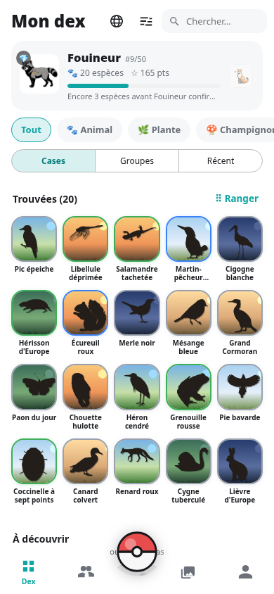
  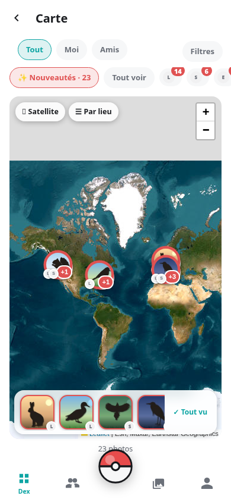
  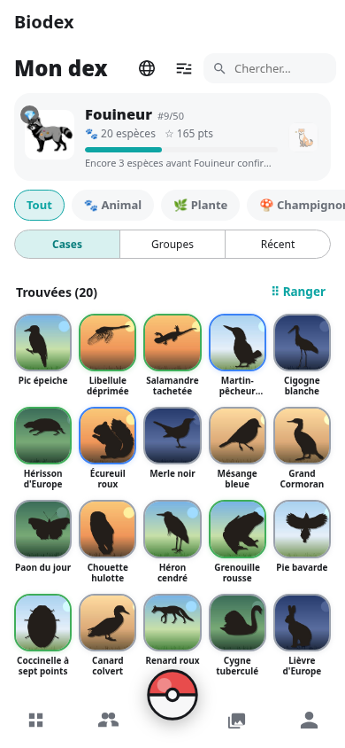
  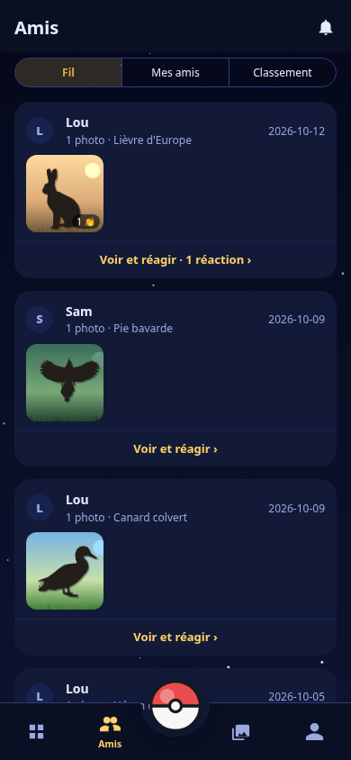
</p>

<h1 align="center">Biodex</h1>

<p align="center"><b>The dex of living things.</b> Photograph whatever you come across, the species gets recognised, the slot fills up. With friends, on your own server.</p>

<p align="center">
  <a href="https://raaatus.github.io/BioDex/">Website</a> ·
  <a href="https://github.com/Raaatus/BioDex/releases/latest">Download the APK</a> ·
  <a href="#host-your-own-server">Host your own server</a> ·
  <a href="#résumé-en-français">Français</a>
</p>

<p align="center">
  
  
  
  
</p>

---

Biodex is a **Pokédex of living things**, free and self-hosted. You photograph an animal, a plant or a mushroom; the photo goes to *your* server, which recognises it among nearly a million species and fills the matching slot in your collection. Your friends do the same, and you compare.

There is **no central server**: each group hosts its own. No email address, no tracking, no account with anyone. Your photos stay with you.

Two clients, one server:

| | |
|---|---|
| **Server** | Python · FastAPI · SQLite. Recognition (MegaDetector, BioCLIP 2, Pl@ntNet, FungiTastic), accounts, the dex, friends, the map. |
| **Web client** | Plain HTML/JS, phone-first. Everything the app does, and it installs on an iPhone home screen. |
| **Android app** | Flutter. The camera, and animations a browser cannot do. |

---

## Contents

- [Screenshots](#screenshots)
- [What Biodex does](#what-biodex-does)
- [How it works](#how-it-works)
- [Host your own server](#host-your-own-server)
- [The web client](#the-web-client)
- [The Android app](#the-android-app)
- [Configuration](#configuration)
- [Upgrading](#upgrading)
- [Languages](#languages)
- [Rebuilding the data yourself](#rebuilding-the-data-yourself)
- [Useful commands](#useful-commands)
- [Privacy and security](#privacy-and-security)
- [Repository layout](#repository-layout)
- [Contributing](#contributing)
- [Credits and licence](#credits-and-licence)
- [Résumé en français](#résumé-en-français)

---

## Screenshots

The web client, on a phone. The Android app shows the same screens. The interface is in French here; switch to English in the settings.

| The dex | A species | Arranging the dex | The map |
|:-:|:-:|:-:|:-:|
|  | 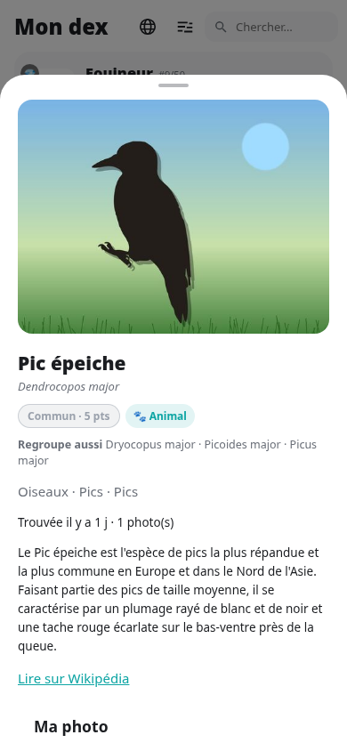 | 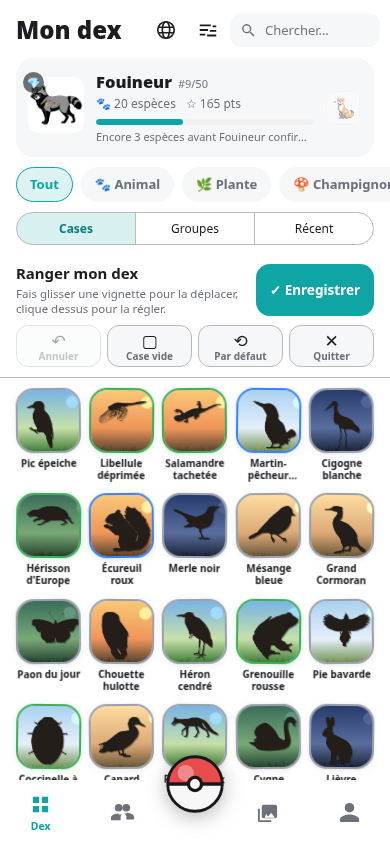 |  |

| A place | Friends feed | Leaderboard | A friend's dex |
|:-:|:-:|:-:|:-:|
| 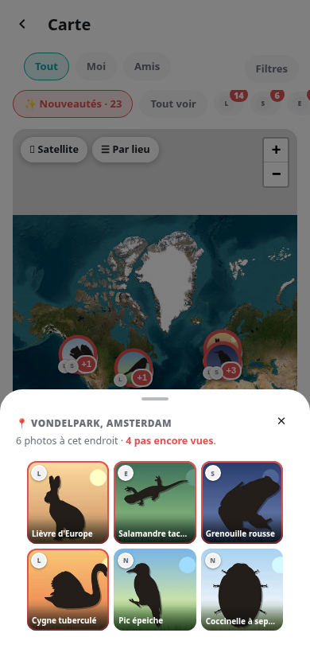 | 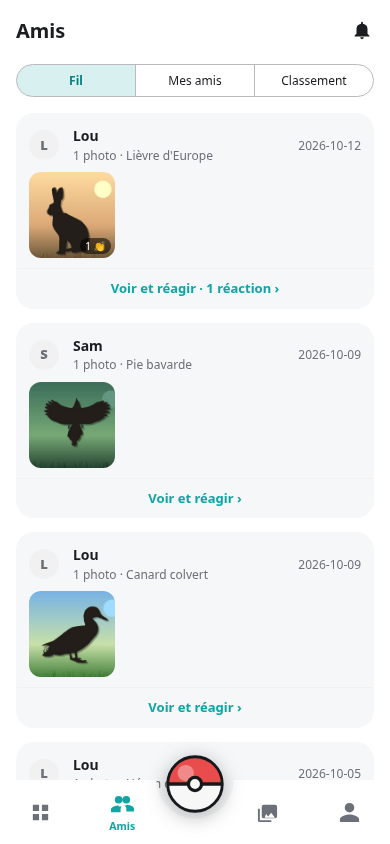 | 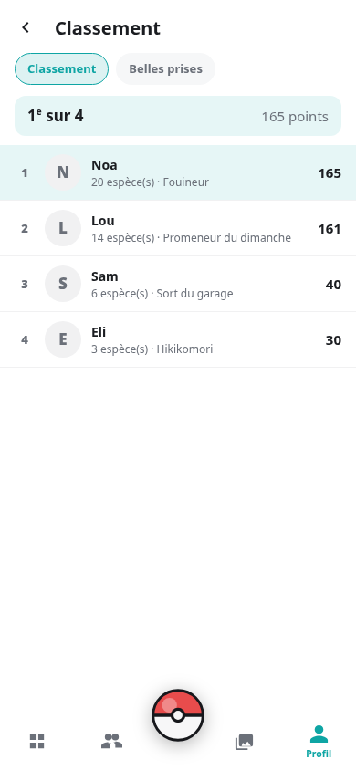 | 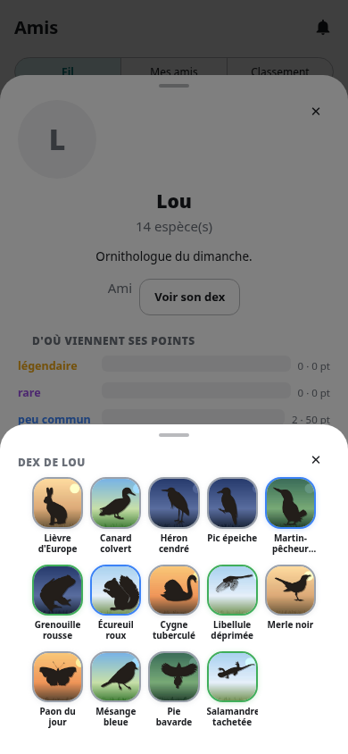 |

| Profile | Achievements | The 50 ranks | Gallery |
|:-:|:-:|:-:|:-:|
| 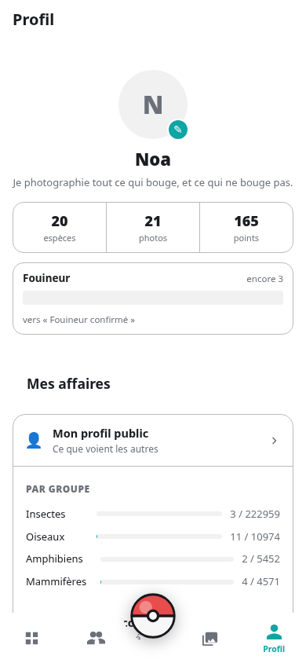 |  | 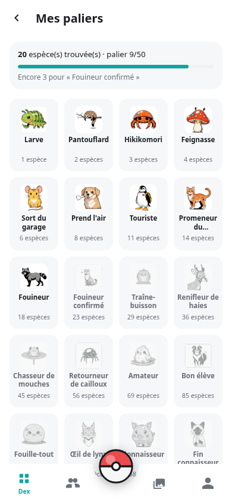 | 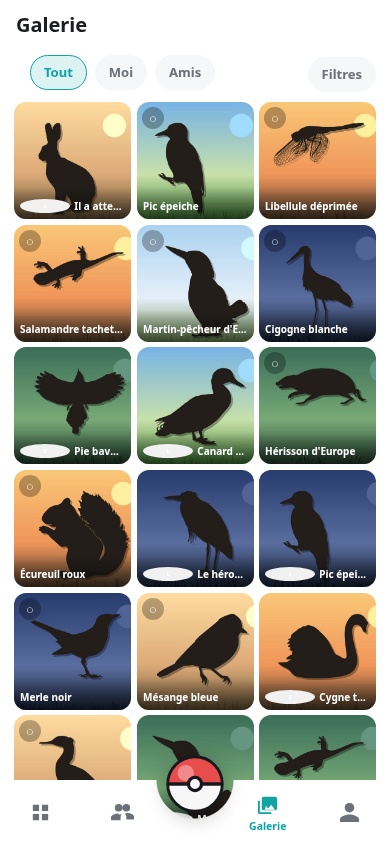 |

| Capture | Settings | In English | Showcase |
|:-:|:-:|:-:|:-:|
| 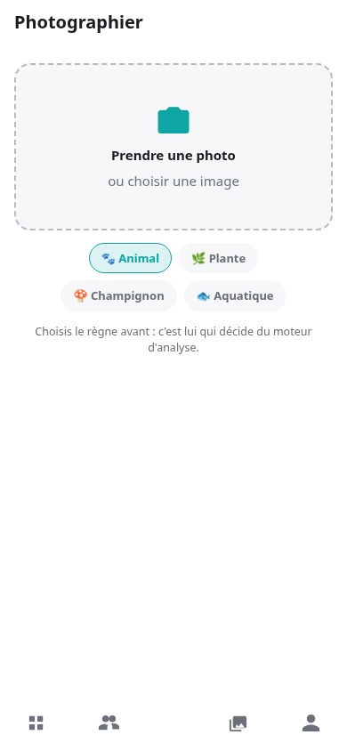 | 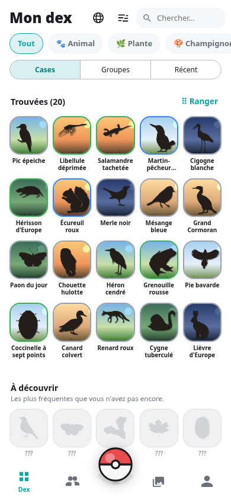 | 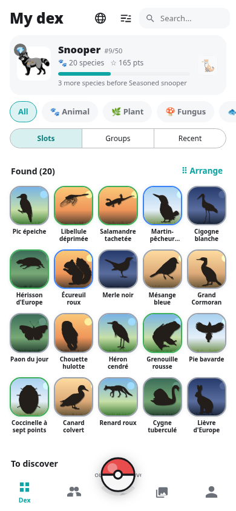 | 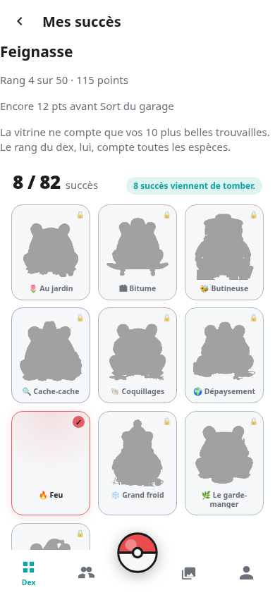 |

Seventeen themes, thirteen of them with an animated backdrop behind the screens:

| Hacker | Abyss | Sakura | Starry night | Forest |
|:-:|:-:|:-:|:-:|:-:|
| 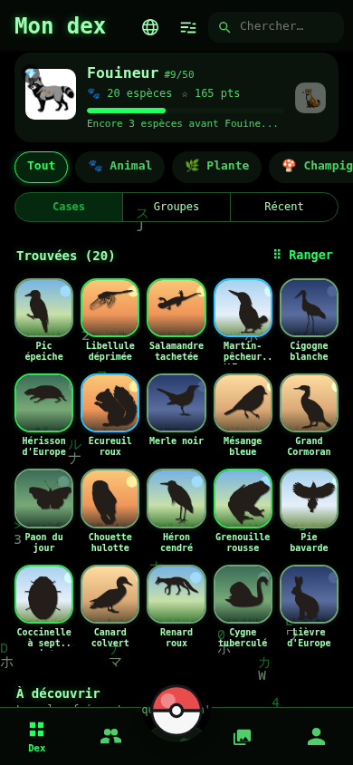 | 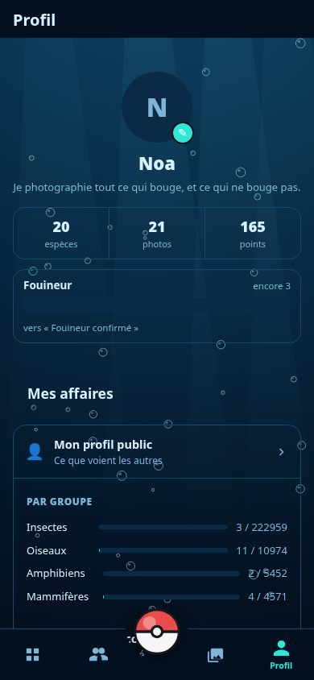 | 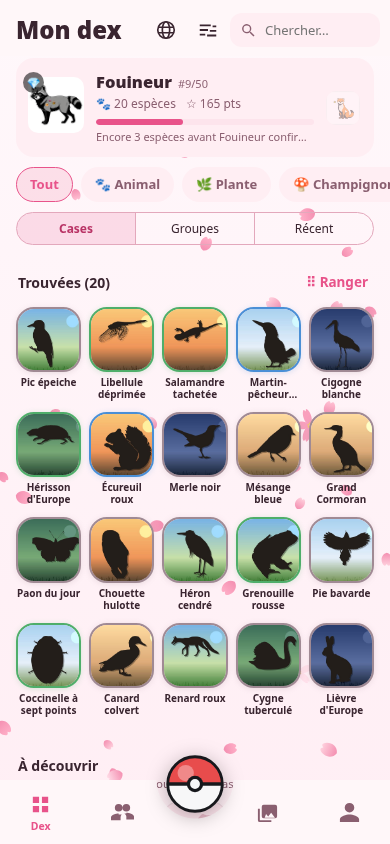 |  | 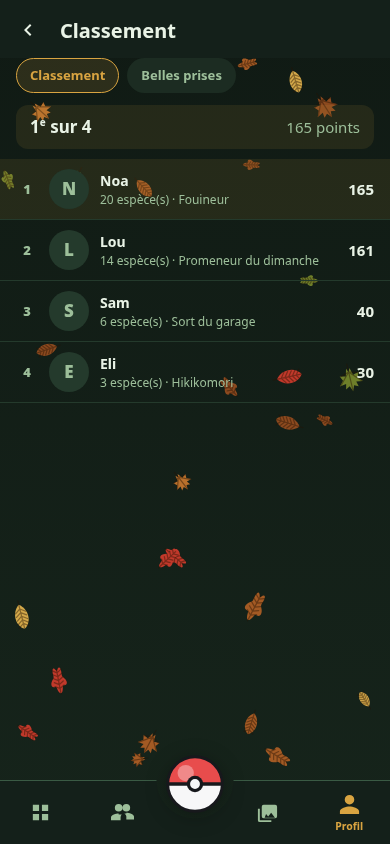 |

---

## What Biodex does

### Photograph and recognise

- **Four kingdoms**, each with its own engine: animals, plants, fungi, and an "aquatic" lens for fish.
- **Before sending**: crop, rotate, adjust the light, **cut the animal out with your finger** to help the engine. The engine gets the cut-out, the gallery keeps the original.
- A verdict, or **several guesses** when the engine hesitates: pick one yourself, or search the whole reference catalogue.
- **When the engine does not know the species** — a cultivar, a breed, a variety — add it to the dex by hand, for everyone. A Wikipedia article can fill it in.
- Fungi flagged as **toxic** are marked, with the warning that goes with it. No recognition should ever decide whether a mushroom is edible.
- iPhone photos (HEIC) are accepted.

### Collect

- **976,000 slots**, one per accepted species: subspecies and synonyms land on the same slot. Typing "Bos indicus" leads to the Cow.
- **Five rarities** — common, basic, uncommon, rare, legendary — worth 5 to 150 points, once per species.
- **Fifty ranks**, from "Larva" to "Go outside, seriously", each with its illustration.
- **82 achievements**, each with its own 3D frog to spin, and a crystal to shatter when earned. The condition of an unearned achievement is hidden; you can reveal it.
- **The showcase**: your ten finest catches, and the rank they give you.
- **Arrange your dex** like a desktop: press and hold, move, resize to 2×2, pick the slot shape, hide, place empty slots. The arrangement follows you from one device to another.
- Three ways to read the dex: slots, groups (class → order → family, with progress), recent. Filters and sorts. **Slots with the full photo** or **the cut-out**, globally or per slot.

### With friends

- Friend requests, activity feed, **five-level reactions** that give points to the photographer, favourites, captions on photos.
- **Tag friends** in a photo: it counts in their dex too, without being sent twice.
- Leaderboard of the circle and best-catches ranking. A friend's profile, showcase, achievements, **their whole dex**.
- **The map**: photos where they were taken, in bubbles that cluster as you zoom out. Filters by person, **new things first** — what your friends posted and you have not seen yet — with a strip to jump to them.
- Photos to locate: drop a pin, search an address, in batches.
- In-app notifications, grouped so they never spam: "So-and-so shared 7 finds", one line per friend.

### Dress it up

- **Seventeen themes.** System, light, dark; Hacker with its falling glyphs; Starry night and its shooting stars; Abyss, Neon, Forest, Sakura, Winter, Northern lights, Summer night with fireflies, Savanna at sunset, Watercolour, Lagoon, Nebula; Notebook and Game Boy.
- Backdrops run at 24 frames per second, pause in the background, and can be frozen with one setting.
- A loading animation that is a spinning frog.

### Stay in control

- Two dates per photo — taken and published — and the choice of which one to show.
- Batch-delete photos without a species; **release** a catch (the photo goes, and the species too if it was the only one).
- Password without an email address, `scrypt` hashing, revocable sessions.
- **English and French**, on the web and in the app, with more languages one JSON file away.

---

## How it works

A photo goes through four stages on the server:

1. **MegaDetector v5a** looks for an animal and crops it. If it only sees a car or a landscape, the photo is rejected right away.
2. **BioCLIP 2** compares the crop to the catalogue — 411,626 Latin names for animals, separate catalogues for plants and fungi.
3. **The observation prior** corrects the raw result. On its own the model puts the roe deer neck and neck with a Chilean deer seen 404 times in history; we reweight by each species' real frequency in GBIF. Measured on the reference set: 3 correct answers out of 10 without it, 10 out of 10 with (`backend/outils/calibre.py`).
4. **Grouping into slots** decides. A slot is not a catalogue entry but an *accepted species*: `Bos taurus`, `Bos primigenius` (the aurochs) and `Bos indicus` (the zebu) are three catalogue entries and a single slot, the Cow. Probabilities are summed per slot before deciding, which removes the hesitation between close relatives.

Plants first go through **Pl@ntNet** if the player entered their key (free, 500 identifications a day), then BioCLIP. Fungi go through **FungiTastic** (2,829 species, far more accurate within its scope) with a fallback to BioCLIP outside it.

### Domestic animals

Two defects added up, both fixed by `outils/domestiques.py`. **The dog was filed with the wolf**: GBIF treats `Canis lupus familiaris` as a subspecies of `Canis lupus`, so a labrador photo filled a "Grey wolf" slot rated rare. The dog now has its own slot. **Breeds existed nowhere**: the classifier is a CLIP, its catalogue does not have to be taxonomy, so 117 breeds are presented to it as plain aliases of their species. Cocker, poodle and cavalier add up on "Dog" instead of splitting.

### Silhouettes

Empty slots show the silhouette of their species, from [PhyloPic](https://www.phylopic.org). When the exact species has no drawing, we walk up its lineage: family, order, class. Horse, donkey and zebra each have their own. About a third of the collection is CC BY or CC BY-SA: the Credits screen names every artist and their licence, and it is not decorative.

Once a species is recognised, the animal is **cut out** (cropped to the MegaDetector box, then background removed) and that cut-out lands in the slot like a sticker.

### Rarities and points

| Rarity | Colour | Points | Share of the dex |
|---|---|---|---|
| Common | grey | 5 | 0.1 % |
| Basic | green | 10 | 46.6 % |
| Uncommon | blue | 25 | 32.5 % |
| Rare | purple | 60 | 15.8 % |
| Legendary | gold | 150 | 5.0 % |

Rarity comes from worldwide GBIF observations, corrected for two biases: obscurity is not a feat (a weevil with eight observations is not legendary — a species must be among the best-observed *of its own group*), and livestock does not get reported (a list of domestic species brings them back to common). Result: pigeon, cow and roe deer common; golden eagle, wolf, lynx, bear rare; tiger legendary.

### Two clients, one API

The web client never reads the database: it goes through the API like the app, from the same origin thanks to a small relay (`serveur_web.py`). Whatever exists in one exists in the other.

---

## Host your own server

### Requirements

- A Linux box (Debian, Ubuntu, Arch… anything) with **Python 3.12**.
- **8 GB of RAM** and **20 GB of disk**: catalogues and models weigh 2.3 GB, the Python dependencies 2.5 GB, the rest is for photos.
- **No GPU needed.** An analysis takes about fifteen seconds on an ordinary CPU; half a second on a GPU.
- [`uv`](https://docs.astral.sh/uv/) to manage the Python environment (`python3 -m venv` and `pip` work too).

### 1. The code

```bash
git clone https://github.com/Raaatus/BioDex.git /opt/biodex
cd /opt/biodex/backend
uv venv .venv
uv pip install -p .venv/bin/python -r requirements-moteur.txt
```

`requirements-moteur.txt` pulls `torch` and the models: that is the heavy part. On a server without a GPU, the CPU wheel is enough and saves 2 GB of CUDA:

```bash
uv pip install -p .venv/bin/python torch torchvision --index-url https://download.pytorch.org/whl/cpu
uv pip install -p .venv/bin/python -r requirements-moteur.txt
```

`requirements.txt` alone installs the API without the engine: handy for client development, photos then stay "pending".

### 2. The data

None of this is in the repository, it is too heavy. The **data pack** is attached to the releases; `backend/donnees.manifeste.json` lists it with checksums:

| File | Size | Role |
|---|---|---|
| `biodex-dex.sqlite` | 436 MB | the reference: 976,000 slots, 1 million aliases, silhouettes, articles — and **no player** |
| `catalogue_v2.pt` | 653 MB | animals encoded by BioCLIP 2, plus 117 breeds |
| `catalogue_plantes.pt` | 704 MB | plants |
| `catalogue_champi.pt` | 273 MB | fungi |
| `catalogue_aquatique.pt` | 38 MB | fish, extracted from the animal catalogue |
| `tete_genres.pt` | 2 MB | the fish "genus" head, trained on FishNet |
| `ft_classes.json`, `ft_toxiques.json` | — | FungiTastic classes and toxic species |
| `modeles/md_v5a.0.1.pt` | 281 MB | MegaDetector v5a |
| `silhouettes.tar` | 44 MB | PhyloPic silhouettes and rank badges |
| `sources-dex.tar` | 17 MB | names and observations, only useful to rebuild the dex |

One script does it all, from the release address:

```bash
.venv/bin/python outils/installe_donnees.py https://github.com/Raaatus/BioDex/releases/download/donnees-v1
```

It checks every checksum, unpacks the archives, and creates `donnees/biodex.sqlite` from the dex database **only if there is none yet** — it never overwrites a database that holds players. BioCLIP 2, FungiTastic and the background-removal model download themselves on first run, from Hugging Face.

### 3. Run

```bash
./run.sh                         # the API, on all interfaces, port 8077
.venv/bin/python serveur_web.py  # the web client, port 8090, relaying /api/ to the API
```

On first start the server creates `donnees/sel_serveur.txt` — **keep it and back it up with the database**: it signs sessions, losing it signs everyone out.

Open `http://your-server:8090`, create an account, take a photo.

### 4. As a service

Two systemd units, in `/etc/systemd/system/`:

```ini
# biodex.service
[Unit]
Description=Biodex — API and recognition
After=network.target

[Service]
User=biodex
WorkingDirectory=/opt/biodex/backend
Environment=BIODEX_DONNEES=/opt/biodex/backend/donnees
Environment=BIODEX_JOURS_AVANT_PURGE=0
ExecStart=/opt/biodex/backend/run.sh
Restart=on-failure

[Install]
WantedBy=multi-user.target
```

```ini
# biodex-web.service
[Unit]
Description=Biodex — web client
After=biodex.service

[Service]
User=biodex
WorkingDirectory=/opt/biodex/backend
ExecStart=/opt/biodex/backend/.venv/bin/python serveur_web.py --port 8090
Restart=on-failure

[Install]
WantedBy=multi-user.target
```

```bash
useradd -r -s /usr/sbin/nologin biodex && chown -R biodex: /opt/biodex
systemctl enable --now biodex biodex-web
journalctl -u biodex -f
```

### 5. HTTPS

The Android app and the web client need an address reachable from the phone; on the Internet, put a reverse proxy in front. With [Caddy](https://caddyserver.com/), certificates come by themselves:

```
dex.example.org {
    reverse_proxy 127.0.0.1:8090
}
api.example.org {
    reverse_proxy 127.0.0.1:8077
}
```

The web client talks to the API through its own relay: exposing `api.example.org` is only for the Android app, which gets that address at first sign-in. Photos can weigh 20 MB: make sure the proxy accepts it (Caddy does by default; under nginx, `client_max_body_size 32m`).

On a local network, without HTTPS, the app accepts an address like `http://192.168.x.x:8077` — the "server in the closet" use case.

### ⚠️ The purge

By default, the server **deletes on start-up** the photos left without a species for more than `BIODEX_JOURS_AVANT_PURGE` days (7). To keep them and settle them yourself from "To settle", set the variable to `0`, as in the unit above.

---

## The web client

It is served by `serveur_web.py` and lives in `backend/web/`: a page, some scripts, no build step. On an iPhone, Safari → Share → **Add to Home Screen** turns it into a full-screen app. It keeps the session, the language, the theme and the image cache.

The web client offers everything the app does, camera included through the browser's file picker, which offers the camera on phones.

---

## The Android app

### Install

The APK is attached to every [release](https://github.com/Raaatus/BioDex/releases/latest). Android will ask to allow installs from outside the Play Store. On first launch the app asks for **the server address** — your API, `https://api.example.org` or `http://192.168.1.20:8077` — then a nickname and a password.

### Build it yourself

```bash
cd app
./installe_toolchain.sh   # Flutter, JDK and Android SDK in app/.toolchain/ (~5.5 GB), nothing system-wide
source env.sh
./build.sh                # produces ../apk/biodex.apk
```

`rm -rf app/.toolchain` removes everything, caches included. To sign with your own key, add an `android/key.properties`; without it the APK is signed with the debug key, which is enough to install.

---

## Configuration

Everything is set through environment variables; nothing is hard-coded. The main ones:

| Variable | Default | Role |
|---|---|---|
| `BIODEX_DONNEES` | `backend/donnees` | where database, photos and catalogues live |
| `BIODEX_BASE` | `$DONNEES/biodex.sqlite` | the database |
| `BIODEX_PHOTOS`, `BIODEX_VIGNETTES`, `BIODEX_DECOUPES`, `BIODEX_AVATARS` | under `$DONNEES` | images |
| `BIODEX_HOTE`, `BIODEX_PORT` | `0.0.0.0`, `8077` | the API listener |
| `BIODEX_SANS_MOTEUR` | — | `1`: the API without recognition |
| `BIODEX_FILS_TORCH` | 8 | CPU threads for inference |
| `BIODEX_JOURS_AVANT_PURGE` | 7 | days before photos without a species are deleted, `0` = never |
| `BIODEX_DUREE_SESSION_JOURS` | 365 | session lifetime |
| `BIODEX_SEUIL_DETECTION` | 0.20 | MegaDetector minimum confidence |
| `BIODEX_SEUIL_CASE`, `BIODEX_RATIO_CASE` | 0.55, 4.0 | when a slot counts as "sure" |
| `BIODEX_PRIOR_OBS` | 1.0 | weight of the observation prior; lower it to hunt rarities |
| `BIODEX_CLIP`, `BIODEX_FUNGI_MODELE` | BioCLIP 2, FungiTastic | the Hugging Face models |
| `BIODEX_MD_POIDS`, `BIODEX_CATALOGUE*` | under `$DONNEES` | weights and catalogues |

The full list, with the comments explaining each threshold, is in [`backend/biodex/config.py`](backend/biodex/config.py).

---

## Upgrading

An upgrade touches neither the photos nor the database: migrations only add. The procedure, with the safety copy, the rebuild of the database on the current schema and the rollback if needed, is in [`backend/MISE_A_JOUR.md`](backend/MISE_A_JOUR.md) (in French).

---

## Languages

Biodex is written in French; every interface text is a key, translated in `i18n/<code>.json`. The same file serves the web client, the app and the server (for the achievement and rank names it serves). English is complete. Adding a language means copying `en.json`, translating, declaring the code in two selectors and running `python3 i18n/genere.py` — all in [`i18n/README.md`](i18n/README.md).

Species names come from the reference data: the French name when GBIF or Wikipedia gives one, the Latin name otherwise.

---

## Rebuilding the data yourself

The pack is enough to run a server. But everything in it can be rebuilt with the scripts in `backend/outils/`, for a fresher dex, another language of names, or simply to understand:

| Script | What it does |
|---|---|
| `construit_dex.py` | reads the GBIF backbone (`simple.txt.gz`) and writes one slot per accepted species, plus the aliases |
| `domestiques.py` | takes dog and pig out of wolf and boar, adds 117 breeds |
| `observations.py` | collects GBIF observation counts, for the prior and the rarities |
| `qualites.py` | assigns the five rarities |
| `noms_francais.py`, `noms_wikidata.py`, `noms_wikipedia.py` | vernacular names |
| `phylopic.py`, `silhouettes.py`, `silhouettes_flore.py` | silhouettes, by lineage |
| `catalogue_poissons.py`, `embeddings_poissons.py`, `tete_poissons.py` | the aquatic catalogue and its "genus" head |
| `succes_especes.py` | precomputes which slots satisfy each achievement |
| `badges_paliers.py`, `modeles_succes.py`, `couleurs_succes.py` | rank and achievement illustrations |
| `toxiques.py` | the list of species flagged as toxic |
| `base_neuve.py` | rebuilds the database on the current schema, keeping everything |
| `calibre.py`, `mesure_analyse.py`, `essai_moteur.py` | measure the engine on a set of known photos |

Each script says at the top what it expects and what it produces. Encoding the catalogues takes a GPU or a lot of patience: 411,626 names to push through BioCLIP.

---

## Useful commands

Accounts, from the server:

```bash
sqlite3 donnees/biodex.sqlite "SELECT id, pseudo, cree_le, vu_le FROM utilisateurs ORDER BY id;"
```

Count what the purge would delete:

```sql
SELECT COUNT(*) FROM captures
 WHERE case_id IS NULL AND etat NOT IN ('attente','analyse')
   AND cree_le < datetime('now', '-7 days');
```

Back up: the database, `sel_serveur.txt`, and the `photos/`, `decoupes/`, `avatars/` folders. The rest downloads or recomputes.

Test:

```bash
cd backend && .venv/bin/python -m pytest -q tests      # server
for f in backend/web/*.js; do node --check "$f"; done  # web client
cd app && source env.sh && flutter analyze && flutter test
```

Make a code archive for a server that already runs: `cd backend && ./paquet.sh --code-seul`.

---

## Privacy and security

- **No email address.** A nickname, a password. In return, a lost password is lost: there is no recovery channel. Hashing is `scrypt` from the standard library.
- **Sessions** are random tokens of which only the fingerprint, salted with `sel_serveur.txt`, is stored: the database alone cannot forge a session.
- **What others see**: a friend's photo is visible only if shared, and only to accepted friends. A stranger sees no dex, no photos, no map.
- **Nothing leaves the server** except what it is asked to fetch: Wikipedia articles (once per species, cached), Nominatim geocoding when searching an address, Pl@ntNet if you gave your key.
- SQLite in WAL mode, a single file to back up.

---

## Repository layout

```
backend/
  biodex/         the server: routes/, moteur.py (recognition), db.py (migrations), schema.sql
  web/            the web client: index.html, app.js, style.css, backdrops (fond.js), dictionaries (lang/)
  outils/         building and measuring the data
  tests/          pytest
  run.sh          starts the API
  serveur_web.py  serves the web client and relays /api/
  paquet.sh       builds a deployment archive
  MISE_A_JOUR.md  upgrading without losing anything
app/
  lib/            the Flutter app: ecrans/, widgets/, themes.dart, i18n.dart
  assets/         3D achievement models, loading animation, dictionaries
  build.sh, env.sh, installe_toolchain.sh
i18n/             translations, and the generator
docs/             the website (GitHub Pages) and the screenshots
```

Code, comments and identifiers are in French. Contributions in English are welcome; see below.

---

## Contributing

Issues and pull requests are welcome; [`CONTRIBUTING.md`](CONTRIBUTING.md) says how. Tests run in CI, and a `v*` tag builds the APK and the server archive as a release.

---

## Credits and licence

Biodex is released under the [MIT licence](LICENSE).

It would not exist without:

- [GBIF](https://www.gbif.org/) — the taxonomic backbone and the observations;
- [PhyloPic](https://www.phylopic.org/) and its contributors — the silhouettes, under CC0, CC BY and CC BY-SA (the Credits screen names them one by one);
- [Wikipedia](https://fr.wikipedia.org/) and [Wikimedia Commons](https://commons.wikimedia.org/) — articles and their illustrations;
- [MegaDetector](https://github.com/microsoft/CameraTraps) — detection;
- [BioCLIP 2](https://imageomics.github.io/bioclip-2/) — recognition;
- [Pl@ntNet](https://plantnet.org/) — plants;
- [FungiTastic](https://huggingface.co/BVRA) — fungi;
- [FishNet](https://fishnet-2023.github.io/) — fish;
- [Nominatim](https://nominatim.org/), OpenStreetMap, Esri, OpenTopoMap — the map;
- [Meshy](https://www.meshy.ai/) — the 3D frogs of the achievements.

---

## Résumé en français

**Biodex est un Pokédex du vivant, libre et auto-hébergé.** On photographie un animal, une plante ou un champignon ; ton propre serveur le reconnaît parmi près d'un million d'espèces et remplit la case correspondante dans ta collection. Tes amis font pareil sur le même serveur, et vous comparez : fil d'activité, réactions, classement, carte des trouvailles avec les nouveautés d'abord, cinquante rangs, 82 succès avec leur grenouille en 3D, une vitrine, dix-sept thèmes à décor animé.

Pas de serveur central, pas de compte chez qui que ce soit : chaque bande héberge le sien. Pas d'adresse mail, pas de pistage. Les photos restent chez toi.

- **Serveur** : Python 3.12, FastAPI, SQLite. Reconnaissance par MegaDetector, BioCLIP 2, Pl@ntNet et FungiTastic. Tourne sur processeur (une quinzaine de secondes par photo).
- **Site web** : HTML/JS sans framework, pensé pour le téléphone, installable sur l'écran d'accueil d'un iPhone.
- **Application Android** : Flutter, avec l'appareil photo. APK sur la page des [releases](https://github.com/Raaatus/BioDex/releases/latest).
- **Langues** : français (source) et anglais, au choix dans les réglages ; une langue de plus, c'est un fichier JSON (voir [`i18n/README.md`](i18n/README.md)).

Démarrage rapide :

```bash
git clone https://github.com/Raaatus/BioDex.git && cd BioDex/backend
uv venv .venv && uv pip install -p .venv/bin/python -r requirements-moteur.txt
.venv/bin/python outils/installe_donnees.py https://github.com/Raaatus/BioDex/releases/download/donnees-v1
./run.sh &                        # l'API sur :8077
.venv/bin/python serveur_web.py   # le site sur :8090
```

Le pack de données (base des espèces sans aucun joueur, catalogues encodés, poids du détecteur, silhouettes — 2,3 Go) est attaché aux releases ; `backend/donnees.manifeste.json` le liste avec ses empreintes. Tout ce qu'il contient se reconstruit avec les scripts de `backend/outils/`.

Mettre `BIODEX_JOURS_AVANT_PURGE=0` pour garder les photos sans espèce au lieu de les voir effacées après sept jours. Sauvegarder `biodex.sqlite`, `sel_serveur.txt` et les dossiers `photos/`, `decoupes/`, `avatars/`. La mise à jour sans rien perdre est décrite dans [`backend/MISE_A_JOUR.md`](backend/MISE_A_JOUR.md).

Licence MIT. Les données et modèles gardent leurs licences — GBIF, PhyloPic (CC0 / CC BY / CC BY-SA, crédités dans l'application), Wikipédia, MegaDetector, BioCLIP 2, Pl@ntNet, FungiTastic.
